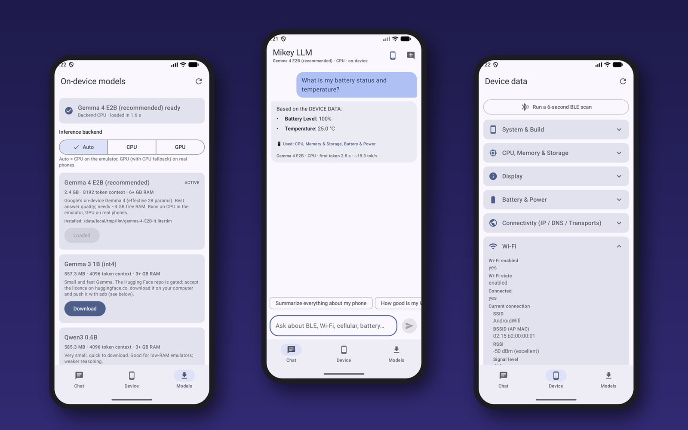
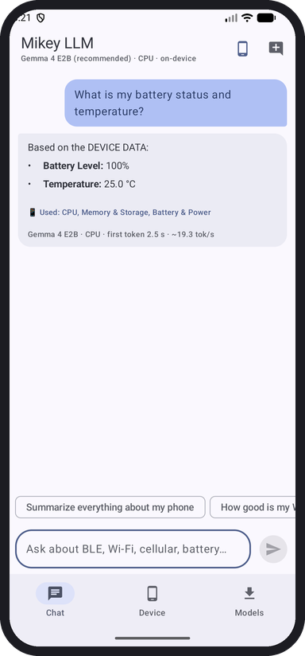
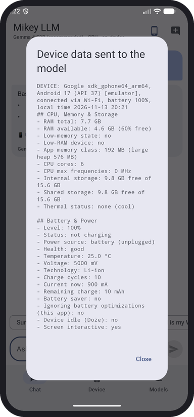
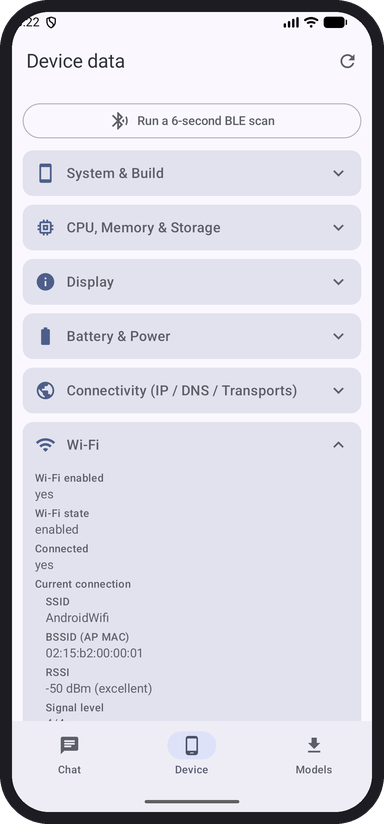
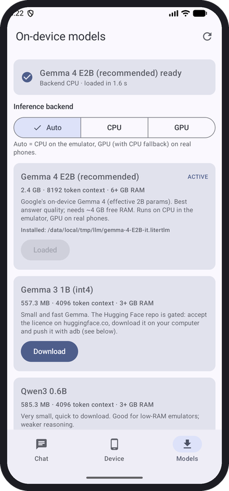
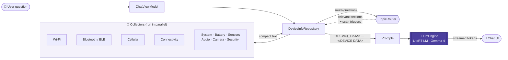
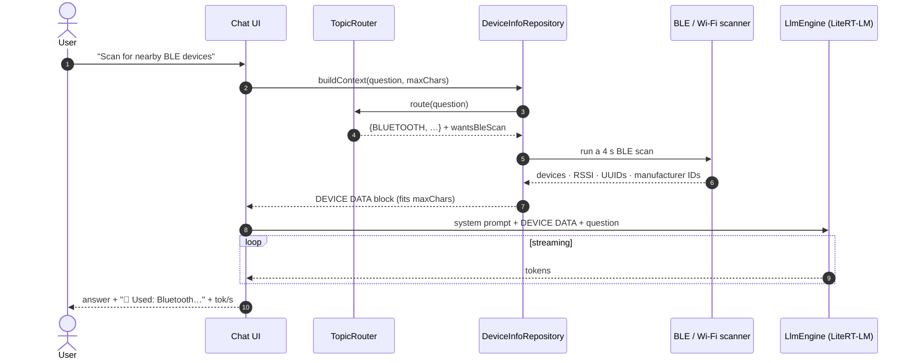

<div align="center">

# 📱 Mikey LLM

### An on-device Android assistant that knows your phone

Ask about **BLE, Wi-Fi, cellular, battery, sensors, networking** and more.<br/>
A Gemma LLM answers **entirely on the device**, using live data read from Android APIs.

-3DDC84?logo=android&logoColor=white)




</div>

---

## ✨ Highlights

| | |
|---|---|
| 🧠 **Local LLM** | Gemma 4 E2B (or Gemma 3 1B / Qwen3 0.6B) runs with **LiteRT-LM**, the successor to the MediaPipe LLM Inference API. CPU on emulators, GPU with CPU fallback on phones. |
| 📡 **Real device context** | 16 device sections read Wi-Fi, BLE, cellular, connectivity, battery, CPU/RAM, sensors, GNSS, audio, cameras, security settings and installed apps. |
| 🎯 **Smart routing** | `TopicRouter` sends only the sections relevant to each question, so the prompt fits the model's context window. |
| 🔍 **Live scans on demand** | "Scan for BLE devices" or "which Wi-Fi networks are around?" triggers a fresh scan before the model answers. |
| 🪟 **Transparent** | Tap **📱 Used: …** under any answer to see exactly which device data was sent to the model. |
| ⚡ **Fast** | ~3–4 s model load and ~20–38 tokens/s on CPU (arm64 emulator, Apple Silicon host). |
| 🔒 **Private** | The internet is used once, to download the model, and you can skip even that by pushing the model with `adb`. |

---

## 📸 Screenshots

All screenshots are from the app running on an API 37 arm64 emulator with Gemma 4 E2B.

<table>
  <tr>
    <th>💬 Chat</th>
    <th>🪟 Context inspector</th>
    <th>📊 Device data</th>
    <th>📦 Models</th>
  </tr>
  <tr>
    <td></td>
    <td></td>
    <td></td>
    <td></td>
  </tr>
  <tr>
    <td>Ask anything. Answers stream in with Markdown, plus the sections used and the speed (first-token latency, tok/s).</td>
    <td>Shows exactly which <code>DEVICE DATA</code> block the model saw for that answer.</td>
    <td>Browse every collector by hand and run a 6-second BLE scan.</td>
    <td>Download or load models and pick the Auto / CPU / GPU backend.</td>
  </tr>
</table>

---

## 🏗️ How it works



### Life of a question



---

## 🚀 Quick start

**Requirements:** Android Studio with SDK 37, an **arm64** (or x86_64) emulator or phone with **≥ 6 GB RAM**
(8 GB recommended), and ~4 GB of free disk.

**1. Build and install**
```bash
git clone https://github.com/mikeybydun1/Mikey-llm-application.git
cd Mikey-llm-application
./gradlew :app:installDebug
```

**2. Launch Mikey LLM** and accept the permission prompts (location, phone, nearby devices).

**3. Get a model** using either option:

* **In the app:** open **Models**, then tap **Download** on *Gemma 4 E2B* (2.4 GB). Downloads resume
  after a dropped connection, and the model loads automatically when the download finishes.
* **With adb** (faster, and the file survives app reinstalls):
  ```bash
  curl -L -o gemma-4-E2B-it.litertlm \
    https://huggingface.co/litert-community/gemma-4-E2B-it-litert-lm/resolve/main/gemma-4-E2B-it.litertlm
  adb shell mkdir -p /data/local/tmp/llm
  adb push gemma-4-E2B-it.litertlm /data/local/tmp/llm/
  adb shell chmod 644 /data/local/tmp/llm/gemma-4-E2B-it.litertlm
  ```
  Then tap ⟳ on the Models tab, or restart the app. You can also push into
  `/sdcard/Android/data/com.example.mikeyllmapplication/files/models/`. Launch the app once first so
  Android creates that folder, and note that uninstalling the app deletes it.

**4. Chat!** Try *"Summarize everything about my phone"*, *"How good is my Wi-Fi signal?"* or
*"Scan for nearby BLE devices"*.

---

## 🧠 Models

| Model | Size | Context | Notes |
|---|---|---|---|
| **Gemma 4 E2B** ⭐ default | 2.4 GB | 8K | Best quality. Ungated on Hugging Face. |
| Gemma 3 1B int4 | 557 MB | 4K | The Hugging Face repo is **gated**: accept the licence, then paste a read token in the Models tab or push the file with adb. |
| Qwen3 0.6B | 585 MB | 4K | Smallest and fastest, with weaker answers. Good for low-RAM emulators. |

To add another `.litertlm` model, add an entry to `llm/ModelCatalog.kt`.

**Backend:** *Auto* uses CPU on emulators (they have no OpenCL) and tries GPU first on real phones,
falling back to CPU. You can force either one in the Models tab.

---

## 📡 What the assistant can see

| Section | Highlights |
|---|---|
| 📶 **Wi-Fi** | SSID/BSSID, RSSI and quality, frequency → band and channel, Tx/Rx link speed, Wi-Fi standard (4/5/6/7), security type, DHCP (gateway, DNS, lease), chipset support (5/6/60 GHz, WPA3, OWE, RTT, P2P), nearby networks from the last scan |
| 🔵 **Bluetooth / BLE** | Adapter state and name, LE 2M / Coded PHY, extended and periodic advertising, LE Audio, paired devices, connected GATT devices, A2DP/HFP state, **live BLE scan** (RSSI and proximity, Tx power, service UUIDs decoded, manufacturer IDs decoded) |
| 📡 **Cellular** | Operator and SIM (MCC/MNC), SIM state, data/voice RAT, 5G NSA/LTE-CA display state, signal level, service state (EARFCN, bandwidths, duplex), serving and neighbour cells (LTE RSRP/RSRQ/SINR/CQI/TA/bands, NR SS-RSRP/SINR, GSM, WCDMA), subscriptions/eSIM |
| 🌐 **Connectivity** | Active and all networks, transports, validated/captive/metered/roaming/VPN, bandwidth estimates, interface, IPs, DNS, gateway, Private DNS, MTU, proxy |
| 🔋 **Battery & power** | Level, status, source, health, temperature, voltage, current, cycles, battery saver, Doze |
| ⚙️ **Others** | System/build, CPU/RAM/storage/thermal, display, location and GNSS, sensors, audio routes and volumes, cameras, hardware features (NFC, UWB, …), security settings, installed apps, permission status |

Summary questions ("summarize everything about my phone") include all sections. Turn device data
off with the 📱 toggle in the chat toolbar to ask the model plain questions.

<details>
<summary><b>🖥️ Emulator notes</b></summary>

* Wi-Fi shows the emulator's virtual `AndroidWifi` AP (2.4 GHz, channel 6, −50 dBm).
* Cellular shows the emulator's simulated carrier. Change signal strength and network type under
  *Extended controls → Cellular*.
* The emulator's Bluetooth stack works, but usually no BLE devices are advertising nearby, so a
  scan correctly reports **0 devices**. Real phones show real devices.
* Set a GPS fix under *Extended controls → Location* to get coordinates.

</details>

---

## 🗂️ Project layout

```
app/src/main/java/com/example/mikeyllmapplication/
├── MikeyApp.kt / AppContainer.kt     DI container, settings, download and auto-load orchestration
├── MainActivity.kt                   Compose host, bottom navigation, runtime permissions
├── llm/
│   ├── LlmEngine.kt                  LiteRT-LM Engine/Conversation wrapper (load, stream, cancel, reset)
│   ├── ModelCatalog.kt               Downloadable models (URLs, sizes, context budgets)
│   ├── ModelManager.kt               Model lookup + resumable HTTP download with retries
│   └── Prompts.kt                    System prompt and DEVICE DATA framing
├── device/
│   ├── DeviceInfoRepository.kt       Collects sections in parallel; builds the per-question context
│   ├── TopicRouter.kt                Question → relevant sections (+ scan triggers)
│   ├── NetworkCollectors.kt          Connectivity + Wi-Fi
│   ├── BluetoothCollector.kt         Bluetooth Classic/BLE + active BLE scanning
│   ├── CellularCollector.kt          Telephony, cells, signal, SIMs, 5G display info
│   ├── SystemCollectors.kt           System, hardware, battery, sensors, audio, camera, …
│   ├── DeviceSection.kt / Format.kt  Data model, failure-tolerant builder DSL, pure formatters
│   └── Permissions.kt
└── ui/  chat/ · device/ · models/ · common/Markdown.kt · theme/
```

---

## 🧪 Tests

```bash
./gradlew :app:testDebugUnitTest          # 23 JVM tests: router, formatters, prompt, Markdown parser
./gradlew :app:connectedDebugAndroidTest  # 4 on-device tests: every collector, BLE scan, context budget,
                                          # and a real LLM answer (runs when a model is installed)
```

> ⚠️ `connectedDebugAndroidTest` uninstalls the app when it finishes, which deletes models stored in
> the app folder. Models in `/data/local/tmp/llm/` are kept.

---

## 🛠️ Troubleshooting

| Problem | Fix |
|---|---|
| "Not enough memory to load this model" | Give the AVD 8 GB RAM (*Device Manager → Edit → Advanced*) or use Qwen3 0.6B. |
| Download stuck on "No internet / DNS failure" | The emulator lost connectivity. Cold-boot the AVD, or use the adb method. |
| SSID shows "hidden" or there are no cell towers | Grant location (Device tab → *Grant permissions*) and switch Location on in quick settings. |
| Release build | `./gradlew :app:assembleRelease` (R8 enabled, signed with the debug key so it installs directly). |

---

<div align="center">

Built with ❤️ using Kotlin, Jetpack Compose and Google AI Edge LiteRT-LM

</div>
